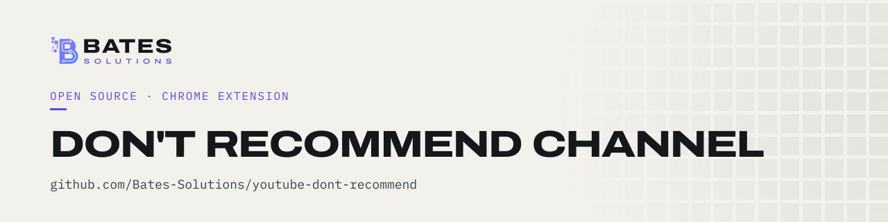
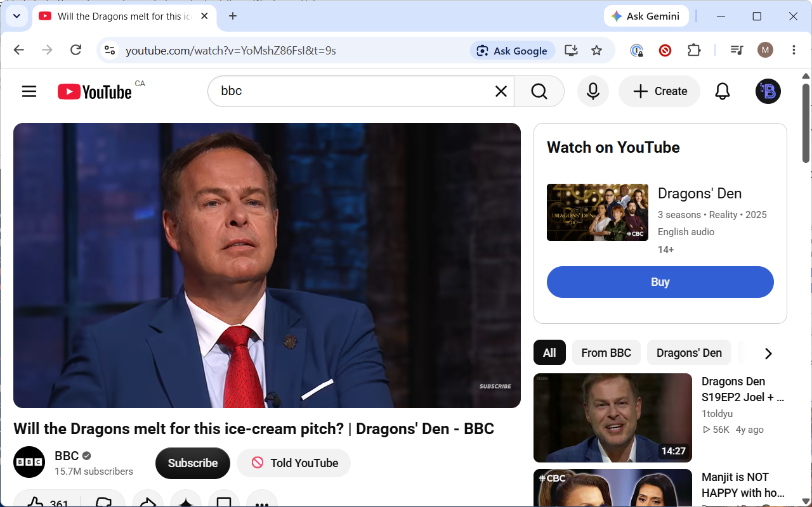
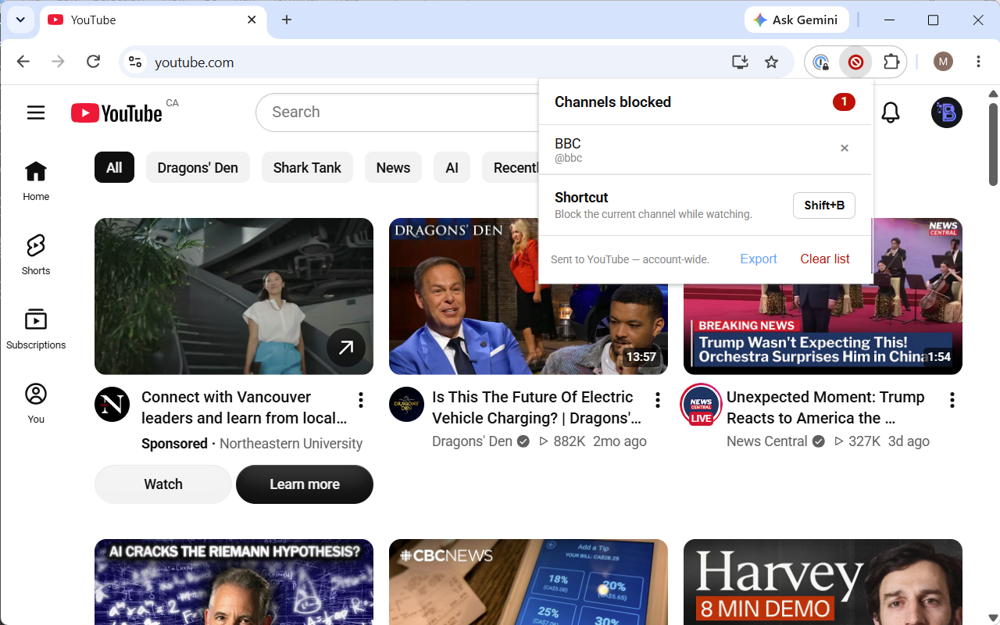

<a href="https://bates-solutions.com/?utm_source=github&utm_medium=readme&utm_campaign=youtube-dont-recommend">
  <picture>
    <source media="(prefers-color-scheme: dark)" srcset=".github/assets/readme-banner-dark.svg">
    
  </picture>
</a>

# YouTube: Don't Recommend Channel

A Chrome and Firefox extension that tells YouTube to stop recommending a channel while you watch
one of its videos.

[](LICENSE)



Watching something and realise it's lazy AI slop? Hit the **🚫 Don't recommend** button next to
Subscribe, or press **Shift+B**, with no digging through the 3-dots menu on a thumbnail. The
extension sends YouTube's own "Don't recommend channel" feedback for that channel, the same signal
as the item in a thumbnail's 3-dots menu. Because it's YouTube's own signal, it applies to your
whole account, on every device, not just this browser.

It works in Chrome, Brave, Edge, Vivaldi and Firefox desktop (140 or later).

## Features

- **Button:** hit **🚫 Don't recommend** next to Subscribe. It changes to **Told YouTube** once
  you've sent the signal for that channel.
- **Keyboard shortcut:** press **Shift+B**. You can rebind it in the popup.
- **A list of the channels you've told YouTube about**, in the popup, with export to JSON.

What it does and doesn't do:

- It **does** send YouTube's "Don't recommend channel" feedback, once per click.
- It **doesn't** hide anything itself. What you see afterwards is up to YouTube's
  recommendations.
- You need to be signed in to YouTube. Signed out, YouTube offers no "Don't recommend channel"
  option.

## Install

It isn't in the Chrome Web Store or on Firefox Add-ons yet. To install it from source in Chrome,
Brave, Edge or Vivaldi:

1. Open `chrome://extensions` (or `brave://extensions`, `edge://extensions`).
2. Turn on **Developer mode** (top right).
3. Choose **Load unpacked** and select this folder.
4. Open any YouTube video. A **🚫 Don't recommend** button appears next to Subscribe.

Chrome may list an "Unrecognized manifest key 'browser_specific_settings'" warning on the
extension's card. That key is for Firefox; the extension works regardless.

In Firefox:

1. Open `about:debugging#/runtime/this-firefox`.
2. Choose **Load Temporary Add-on** and select `manifest.json` in this folder.
3. Open any YouTube video. A **🚫 Don't recommend** button appears next to Subscribe.

Firefox removes a temporary add-on when it restarts. To keep it installed before it's on Firefox
Add-ons, sign it for yourself with `npx web-ext sign --channel=unlisted` (it needs a free
Firefox Add-ons API key), or use Firefox Developer Edition or Nightly with
`xpinstall.signatures.required` set to `false` in `about:config`. Your list of channels is kept separately in each browser.

## Usage

### The popup



Click the extension's toolbar icon to:

- See the channels you've told YouTube about (newest first) and open their pages.
- Remove a channel from that list (× button). This only edits the list; it doesn't undo the
  signal at YouTube.
- Rebind the keyboard **Shortcut** (click it, then press your combo).
- **Export** the list as JSON, or **Clear list**.

### Undoing it

Use Google's own controls: in My Activity, under "Other activity", "YouTube 'Not interested'
feedback" can be deleted. That clears all of it at once, not one channel.

## How it works

Every video thumbnail YouTube shows you comes with its own "Don't recommend channel" token, the
one its 3-dots menu would send. The extension keeps the tokens it sees, so when you click a
thumbnail and then hit the button on the watch page, it sends that video's token. If it has none
for the video (a direct link, or a page you reloaded), it uses the newest token it has seen for
the same channel.

If it has no token for the channel at all, it falls back to one of the channel's videos in the
recommendations next to the video: it opens that video's 3-dots menu (hidden, so nothing flashes)
and clicks the item. If none of the channel's videos are there either, it says so; scroll the
sidebar and try again.

- `page.js` runs in YouTube's own page context (`"world": "MAIN"`), because the content script
  can't see YouTube's page data. It reads the "Don't recommend channel" token off each video card
  in `ytInitialData`, the `yt-navigate-finish` event and the responses to YouTube's own
  `/youtubei/v1` requests, picking the item by its icon (`REMOVE`) rather than its text, and
  passes only the token string on. To send one, it builds the feedback command for that token and
  hands it to YouTube's own command dispatch, so YouTube sends it with your sign-in, and it checks
  YouTube's `/youtubei/v1/feedback` response to confirm it was processed.
- `content.js` adds the watch-page button and the shortcut, validates and saves the tokens by
  video ID, chooses which one to send (taking the channel from the player response, since the
  page's owner link can lag behind in-page navigation), and runs the sidebar fallback. A
  `MutationObserver` and YouTube's `yt-navigate-finish` events keep the button in place through
  the site's single-page navigation.

## Limitations

- The token path doesn't depend on YouTube's language. The sidebar fallback matches the menu item
  by the text "…recommend channel", so the fallback works on **English** YouTube only.
- How long a saved token stays valid isn't known yet. Each send's token age is in the send log; a
  token YouTube no longer accepts falls back to the sidebar.
- The command dispatch YouTube uses isn't a documented API. `page.js` tries two ways of calling it
  and records which one worked.
- YouTube changes its page data and DOM often. If the button stops appearing or the signal stops
  sending, `page.js` and the selectors in `content.js` may need a refresh. Please open an issue if
  it does.

## Privacy

Saved tokens (up to 1,000, newest kept), the list of channels you've signalled, your shortcut, and
a log of the last 100 token sends live in `chrome.storage.local`, in your browser. The only network
activity is the feedback itself, sent to YouTube under your own session when you ask; the developer
neither sees nor receives any of it. The full policy is in [PRIVACY.md](PRIVACY.md).

## Development

```sh
node --test test/*.test.mjs
```

The tests run `page.js` against sample YouTube data with the browser stubbed out. They need Node
22 or later and nothing else. `test/` isn't part of the extension; leave it out of the store zip.

## Security

Please report a vulnerability privately, as described in
[SECURITY.md](https://github.com/Bates-Solutions/.github/blob/main/SECURITY.md). Don't open a
public issue for it.

## Contributing

Contributions are welcome. See
[CONTRIBUTING.md](https://github.com/Bates-Solutions/.github/blob/main/CONTRIBUTING.md) and the
[code of conduct](https://github.com/Bates-Solutions/.github/blob/main/CODE_OF_CONDUCT.md).

## License

[MIT](LICENSE).

---

<a href="https://bates-solutions.com/?utm_source=github&utm_medium=readme&utm_campaign=youtube-dont-recommend">
  <picture>
    <source media="(prefers-color-scheme: dark)" srcset="https://raw.githubusercontent.com/Bates-Solutions/.github/main/brand/bates-solutions-on-dark.svg">
    
  </picture>
</a>

Made by [Bates Solutions](https://bates-solutions.com/?utm_source=github&utm_medium=readme&utm_campaign=youtube-dont-recommend).
